# What's the Weather Like? Weather and Travel APIs


How does weather change as you approach the equator? This project collects live weather for **585 random cities worldwide** from the OpenWeatherMap API, tests how temperature, humidity, cloudiness and wind relate to latitude, and then uses the Google Places API to find hotels in cities with ideal vacation weather.

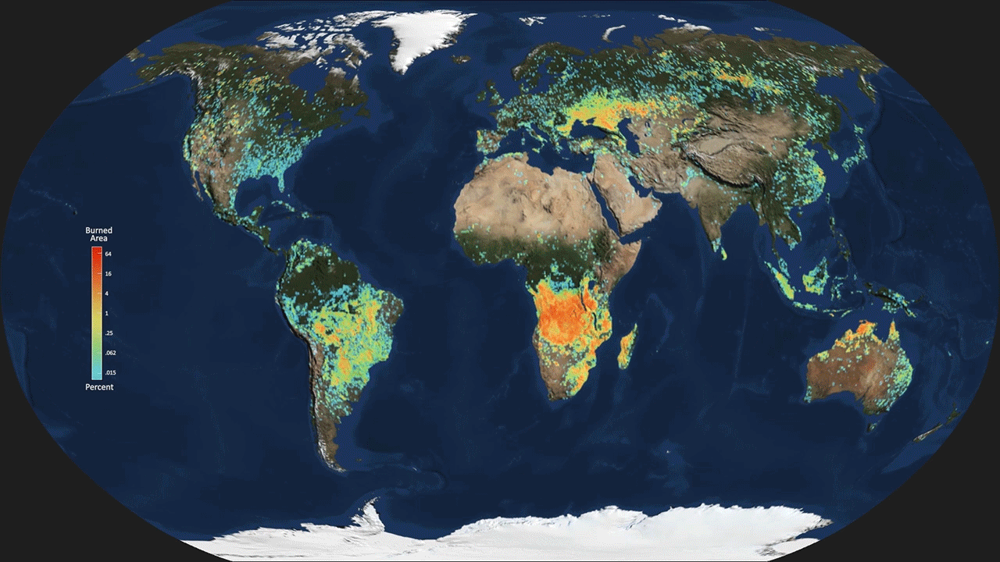

📓 Notebooks: **[WeatherPy](https://nbviewer.org/github/ermiasgelaye/python-api-challenge/blob/master/WeatherPy/WeatherPy.ipynb)** · **[VacationPy](https://nbviewer.org/github/ermiasgelaye/python-api-challenge/blob/master/VacationPy/VacationPy.ipynb)**

## Key findings

Snapshot taken on **23 June 2020** (northern-hemisphere summer). Each cell is the Pearson correlation *r* between latitude and the weather variable.

| Variable | Northern hemisphere (n = 386) | Southern hemisphere (n = 199) | Interpretation |
|---|---:|---:|---|
| Max temperature | **−0.66** | **+0.72** | Strong: it gets warmer toward the equator in both hemispheres |
| Humidity | −0.05 | −0.04 | No meaningful relationship |
| Cloudiness | −0.07 | −0.05 | No meaningful relationship |
| Wind speed | +0.02 | −0.10 | No meaningful relationship |

- **Latitude is a strong predictor of temperature and nothing else.** Humidity, cloud cover and wind are spread fairly evenly regardless of distance from the equator.
- **The temperature gradient is lopsided.** In June, temperatures fall off more steeply toward the southern pole, which is in winter, than toward the north.
- **This is a single-day snapshot.** Repeating the collection across seasons would be needed to separate seasonal effects from latitude effects.

## Part I: WeatherPy

1. Generates 500+ random, non-repeating cities with [`citipy`](https://pypi.org/project/citipy/).
2. Calls the [OpenWeatherMap API](https://openweathermap.org/api) for each city's max temperature, humidity, cloudiness and wind speed, logging every request.
3. Saves the results to [`city_weather_data.csv`](WeatherPy/output_data/city_weather_data.csv).
4. Plots each variable against latitude, then fits a linear regression separately for each hemisphere.

| Temperature | Humidity |
|---|---|
| 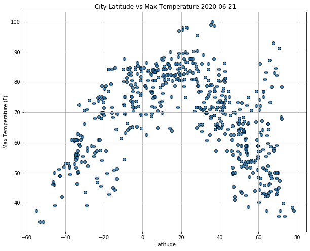 | 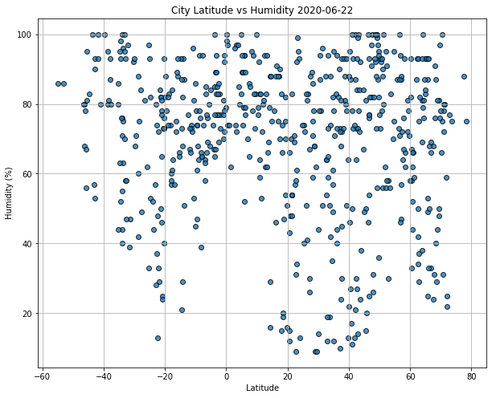 |
| **Cloudiness** | **Wind speed** |
| 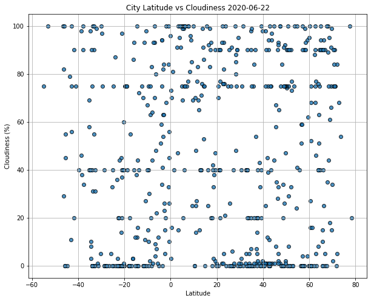 | 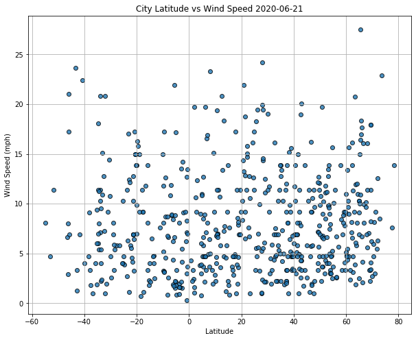 |

<details>
<summary>Regression plots by hemisphere</summary>

| | Northern hemisphere | Southern hemisphere |
|---|---|---|
| Temperature | 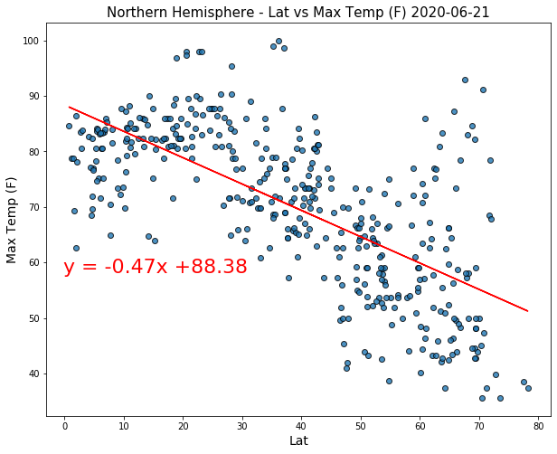 | 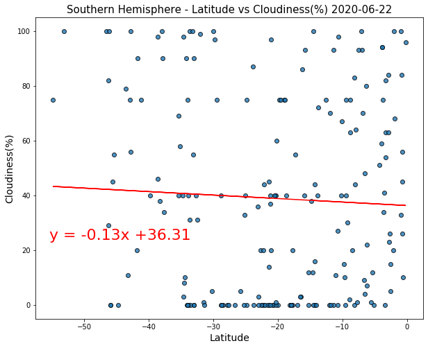 |
| Humidity | 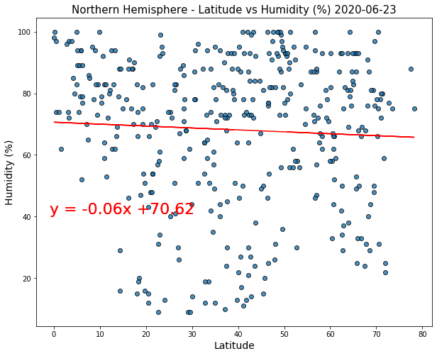 | 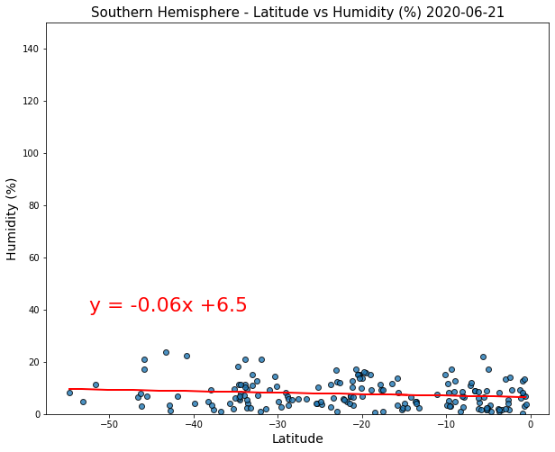 |
| Cloudiness | 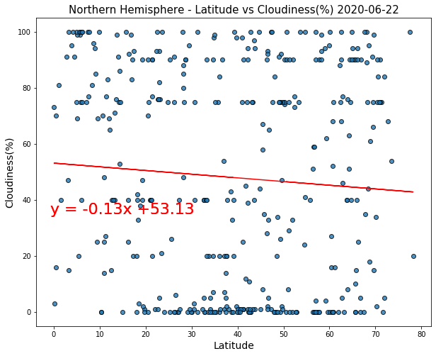 |  |
| Wind speed | 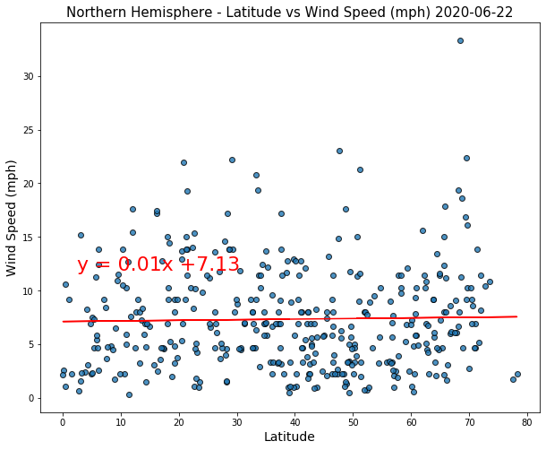 | 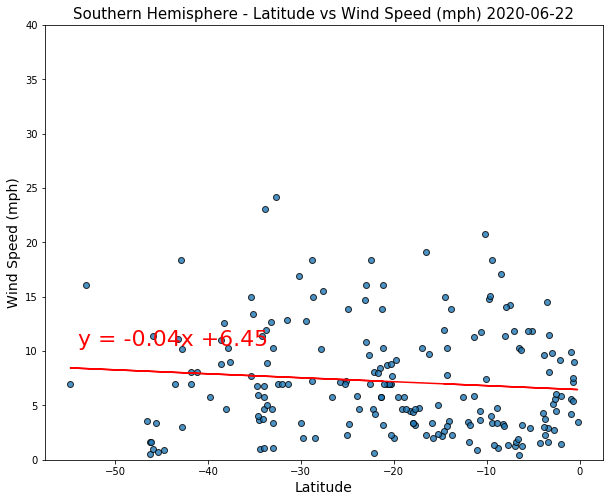 |

</details>

## Part II: VacationPy

Using the weather data from Part I:

1. Plots a **humidity heatmap** of every city with `jupyter-gmaps`.
2. Narrows the list to cities with ideal vacation weather: a max temperature between **70 and 80 °F**, wind under **10 mph** and **0% cloudiness**.
3. Uses the **Google Places API** to find the first hotel within **5 km** of each of those cities and pins it on the map with its name, city and country.

| Humidity heatmap | Hotels in ideal-weather cities |
|---|---|
| 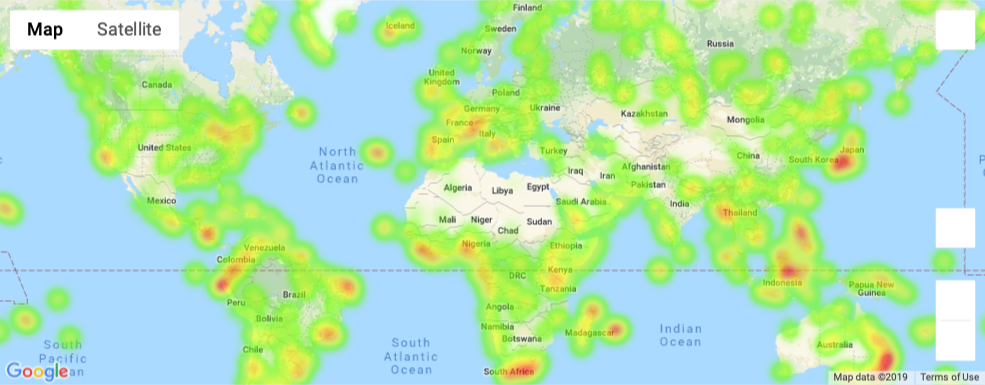 | 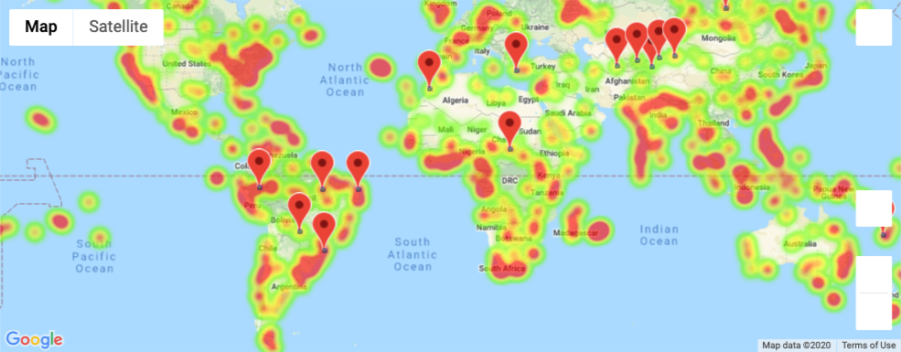 |

## Getting started

```bash
git clone https://github.com/ermiasgelaye/python-api-challenge.git
cd python-api-challenge
pip install pandas numpy matplotlib scipy requests citipy gmaps jupyter
```

### API keys

Both notebooks read their keys from an `api_keys.py` file next to them. The committed files contain placeholders only.

| Notebook | File | Key | Where to get it |
|---|---|---|---|
| WeatherPy | `WeatherPy/api_keys.py` | `weather_api_key` | [OpenWeatherMap](https://home.openweathermap.org/api_keys) |
| VacationPy | `VacationPy/api_keys.py` | `g_key` | [Google Cloud Console](https://console.cloud.google.com/apis/library/places-backend.googleapis.com) (enable the **Places API**) |

```python
# api_keys.py
weather_api_key = "YOUR_OPENWEATHERMAP_KEY"
g_key = "YOUR_GOOGLE_API_KEY"
```

> Don't commit real keys. To stop git from tracking your local edits, run `git update-index --skip-worktree WeatherPy/api_keys.py VacationPy/api_keys.py`.

Then run `jupyter notebook`. If the gmaps widgets don't render, enable the extension with `jupyter nbextension enable --py gmaps`.

## Project structure

```
python-api-challenge/
├── WeatherPy/
│   ├── WeatherPy.ipynb        # data collection and analysis
│   ├── api_keys.py            # OpenWeatherMap key (placeholder)
│   └── output_data/           # city_weather_data.csv and all charts
├── VacationPy/
│   ├── VacationPy.ipynb       # heatmap and hotel search
│   ├── api_keys.py            # Google key (placeholder)
│   └── output_data/
└── Images/                    # README images
```

## Author

**Ermias Gelaye** · [Portfolio](https://ermiasgelaye.github.io) · [GitHub](https://github.com/ermiasgelaye)
